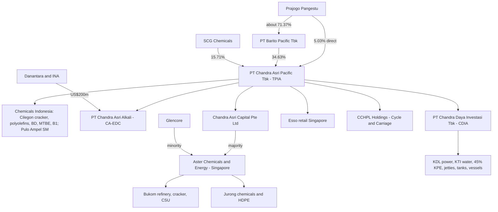
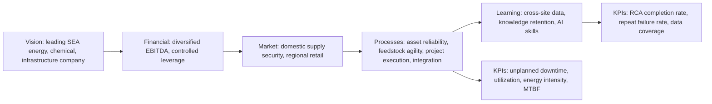
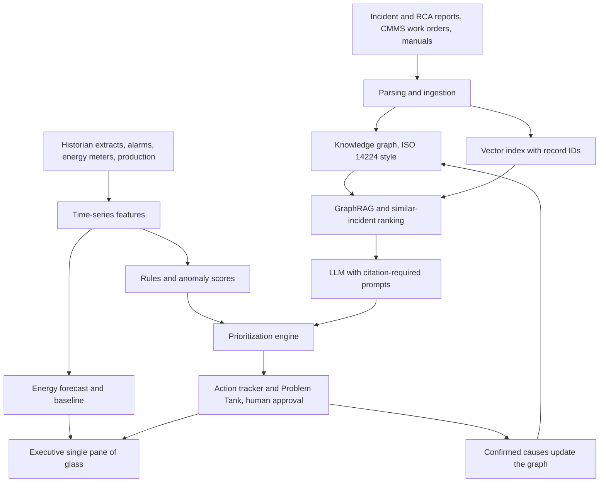

# Chandra Asri Group (PT Chandra Asri Pacific Tbk): CALIBER 2026 Intelligence and Strategic Business Assessment, as of 4 November 2026

Chandra Asri is in a transitional investment phase, with no sign of financial distress. Its 2026 earnings come mainly from the Singapore refinery it bought from Shell in 2025, while its original Indonesian petrochemical business is still under cyclical pressure. Debt and spending on acquisitions have risen sharply, so the company now depends on reliable operation of complex, ageing assets in two countries. That dependence is the strongest commercial reason for an AI reliability and root cause analysis (RCA) solution.

**TL;DR**
- **Business and financial condition:** For 9M 2026 (unaudited), revenue was about US$8.2 billion, EBITDA US$981 million (12.0% margin) and liquidity US$4.2 billion. Quarterly EBITDA fell from US$421 million in Q1 to about US$178 million in Q3 (my calculation from reported totals). The reported 2025 profit of US$1.45 billion was mostly a one-off US$1.868 billion gain from buying the Aster assets below fair value.
- **Strategic direction:** Under its "BIG, LONG, DIVERSIFIED" strategy, the company has moved from a single-site Indonesian petrochemical producer to a regional energy, chemicals, infrastructure and mobility group. Recent steps:
  - Aster, the Shell Singapore refinery and chemicals park (April 2025).
  - Esso Singapore fuel stations (January 2026).
  - Cycle & Carriage car dealerships (October 2026).
  - The CA-EDC chemical plant in Cilegon, an investment of about US$800 million (Kompas puts it at about Rp15 trillion). Chrysanthi Tarigan said on 2 Nov 2026, quoted by Bloomberg Technoz: "Per November ini kita progresnya sudah 85%" ("As of this November, progress is already 85%"). Commercial operation is targeted for 2027.
- **Best hackathon directions** (from my weighted scoring, which is an analytical judgment):
  1. Evidence-traceable AI root cause analysis with similar-incident retrieval and a "Problem Tank".
  2. Risk-based alert and maintenance prioritization with closed-loop action tracking.
  3. Cross-site energy forecasting and an energy-intensity dashboard.
  
  I could not access the four uploaded CALIBER documents. Part IV gives a template for analyzing them and does not invent their content.

---

## How to read this report

- **Labels:**
  - [FACT]: verified in a company filing or a reliable report of one.
  - [MGMT]: management statement or target.
  - [3P]: third-party analysis.
  - [INTERP]: my interpretation.
  - [HYP]: hypothesis to validate.
- **Entities:** "TPIA" is the IDX ticker of PT Chandra Asri Pacific Tbk, the listed company. "Chandra Asri Group" is the company's own brand for itself and its consolidated subsidiaries. It is separate from the wider Prajogo Pangestu business network (Barito Pacific, Barito Renewables, Petrindo).
- **Units:** US dollars unless stated; TPIA reports in US dollars. Derived numbers show the calculation.

**Limitation on uploaded documents.** The four files in the Claude Project "Caliber 2026" were not available to me in this session:
1. Caliber 2026 BCC _ Hackathon Analysis.md
2. consolidated_root_cause_analysis_reports.md
3. equipment_incident_data_markdown.md
4. Caliber Consensus Paper Research.md

I had no connected file tool, so I cannot confirm their content and have not guessed it. Part IV gives an analysis template and the consolidated table format.

---

# PART I. EXECUTIVE INTELLIGENCE BRIEF

## 1. One-page company overview

| Item | Evidence | Label |
|---|---|---|
| Legal entity | PT Chandra Asri Pacific Tbk (IDX: TPIA), renamed from PT Chandra Asri Petrochemical Tbk\[1\] after the 2023 move into "chemical and infrastructure solutions" (2025 Annual Report)\[2\] | FACT |
| Vision | "A leading energy, chemical, and infrastructure solutions company in South East Asia" (2025 Annual Report, April 2026)\[2\] | MGMT |
| Strategy | "BIG, LONG, and DIVERSIFIED": BIG is energy solutions, LONG is chemical expansion downstream, DIVERSIFIED is infrastructure\[2\] | MGMT |
| Indonesian core | Cilegon naphtha cracker (900 KTA ethylene, 490 KTA propylene), polyolefins, butadiene, MTBE and Butene-1, styrene monomer at Pulo Ampel\[3\]\[4\] | FACT |
| Singapore core (Aster) | Bukom refinery 237 kbd (thousand barrels per day),\[5\] Bukom ethylene cracker 1,100 KTA, Jurong Island chemicals about 2,400 KTA, 70 kbd condensate splitter, Aster Polymer Solutions (ex-Chevron Phillips HDPE, bought May 2025)\[2\]\[6\] | FACT |
| Infrastructure | PT Chandra Daya Investasi Tbk (CDI, listed July 2025): about 500 MW combined cycle power (including 200 MW via 45% of Krakatau Posco Energy), 4,874 liters per second of water treatment, 18 jetties, about 5 million m3 of tanks, 14 vessels\[2\]\[6\]\[7\] | FACT |
| Mobility | Esso Singapore stations (1 January 2026); Cycle & Carriage Singapore and Malaysia (15 October 2026)\[2\]\[6\]\[8\]\[9\] | FACT |
| Shareholders (30 Sept 2026) | Barito Pacific 34.63%, SCG Chemicals 15.71%, Prajogo Pangestu 5.03% direct\[10\] | FACT (company website) |
| 9M 2026 (unaudited, 30 Oct 2026) | Net sales US$8.2 billion; EBITDA US$981.0 million; comprehensive income US$394.9 million; total assets US$14.2 billion; equity US$5.0 billion; liquidity US$4.2 billion\[8\]\[11\]\[12\] | FACT (company release via Kontan) |

## 2. Current business condition

- **Earnings now come mainly from Singapore refining.**
  - [FACT] The energy segment produced about 55% to 60% of Q1 2026 revenue (sectors.app says 55%, Metro TV says 60%).\[5\]\[13\]
  - [MGMT] The IDX filing of 13 April 2026 carries the headline "RECORD Q1 2026 EBITDA OF USD 421 MILLION, DRIVEN BY EXCEPTIONAL REFINERY PERFORMANCE ... AMID CHALLENGING PETROCHEMICAL INDUSTRY CONDITIONS". Q1 net profit was US$205 million.
- **Petrochemicals are still weak.**
  - [MGMT] The same release mentions "challenging petrochemical industry conditions".\[14\]
  - [3P] S&P Global Ratings, in "Industry Credit Outlook 2026: Chemicals" (14 Jan 2026), states that "Utilization rates for most commodity chemicals in Asia are likely to remain weak (about 75%-76% for ethylene in 2026-2027)".
- **Momentum faded during 2026.** [INTERP] Quarterly EBITDA derived from reported totals, in US$ million:

  | Quarter | EBITDA | How derived |
  |---|---|---|
  | Q1 2026 | 421 | Reported |
  | Q2 2026 | about 382 | 803 for H1 minus 421 |
  | Q3 2026 | about 178 | 981 for 9M minus 803 |

  Q3 revenue was about US$2.84 billion (8.19 minus 5.35), giving a Q3 EBITDA margin of about 6.3%.\[15\]\[16\] I cannot confirm the cause from the sources. It is consistent with refining margins normalizing after the early-2026 Middle East disruption.
- **Projects near start-up.**
  - [MGMT] CA-EDC: Head of Corporate Communication Chrysanthi Tarigan told Bloomberg Technoz on 2 Nov 2026: "Per November ini kita progresnya sudah 85%. Jadi semoga nanti 2027 kita sudah bisa beroperasi secara komersial." ("As of this November, progress is already 85%. So we hope to be in commercial operation in 2027.") IDXChannel reports commercial operation targeted for the second half of 2027.
  - [MGMT] With the H1 2026 results, management guided that the condensate splitter unit (CSU) and single buoy mooring (SBM) starting in Q4 2026 would add about US$20 million of EBITDA per month (Quartr summary, 29 Jul 2026).\[17\] This is a target, not a result.

## 3. Financial health and strategic direction (summary)

- [INTERP] Liquidity is healthy (US$4.2 billion at 30 Sept 2026) and profitability is moderate.
- Leverage is clearly higher: bank loans plus bonds rose from US$1.99 billion at end-2024 to about US$5.0 billion at end-2025 (audited FY2025).
- FY2025 operating cash flow of US$349.9 million did not cover capital investment of US$736.4 million.\[18\]
- [MGMT] Strategy: a diversified Southeast Asian energy, chemicals, infrastructure and mobility platform. It is built through programmatic M&A, import-substitution chemicals (CA-EDC) and recurring-income infrastructure. Partners are Glencore (Aster), Danantara and INA (CA-EDC), and earlier SCG.

## 4. Major risks (analytical)

1. Refining and petrochemical margin cycles.
2. Integration risk from many acquisitions in 18 months.
3. Reliability of ageing assets: Cilegon has run for more than 33 years (company, January 2026).\[14\]\[19\]
4. Leverage and refinancing.
5. Singapore carbon tax rising to S$45 per tonne CO2e in 2026 to 2027 (S&P Global, May 2024).\[3\]
6. Shareholder change after SCG's partial exit.\[20\]

## 5. Most important innovation opportunities

My scoring model (Section 21) ranks three directions highest:
- Traceable AI-assisted RCA: 4.15 out of 5.
- Risk-based prioritization with action tracking: 4.10.
- Energy forecasting: 3.90.

All three fit the CALIBER 2026 theme, "Future-Ready Operational Excellence: Knowledge, Reliability, and Smart Manufacturing" (ITB Multikampus listing, 27 Aug 2026), and the Case 2 brief.

---

# PART II. CORPORATE AND INDUSTRY DEEP DIVE

## 7. History and milestones

| Year | Milestone | Source |
|---|---|---|
| 1989 or 1992 | Dealroom gives 1989 as the founding year; the company's Q1 2026 release says "since its establishment in 1992".\[14\]\[21\] This discrepancy is unresolved | FACT with conflict |
| 2011 | Tri Polyta Indonesia and Chandra Asri merge on 1 January into PT Chandra Asri Petrochemical Tbk;\[22\] SCG Chemicals takes a stake\[10\]\[21\] | FACT |
| 2022 to 2023 | Agreement to acquire PT Krakatau Daya Listrik (KDL) and PT Krakatau Tirta Industri (KTI)\[2\] | FACT |
| May 2024 | Shell confirms sale of its Singapore park to CAPGC, a Chandra Asri and Glencore JV (S&P Global)\[3\] | FACT |
| Apr to May 2025 | Aster acquisition closes; Chevron Phillips Singapore Chemicals acquired\[2\]\[22\] | FACT |
| Jul 2025 | CDI lists on the IDX as CDIA\[7\]\[23\] | FACT |
| 1 Jan 2026 | Esso Singapore network acquired from ExxonMobil\[2\]\[6\]\[13\] | FACT |
| Jun 2026 | SCG Chemicals sells about 13.67% of TPIA\[20\] | FACT (SCC filing via IDXChannel, 7 Jun 2026) |
| 15 Oct 2026 | Cycle & Carriage acquisition completed\[8\] | FACT (Kontan, 30 Oct 2026) |

## 8. Ownership, governance and leadership

**Shareholders (company website, as of 30 September 2026):**
- PT Barito Pacific Tbk: 29,957,670,400 shares (34.63%).
- SCG Chemicals: 13,589,972,562 shares (15.71%).
- Prajogo Pangestu: 4,354,382,164 shares (5.03%).

- Prajogo Pangestu owns about 71.37% of Barito Pacific (MarketScreener, 30 Dec 2025),\[24\] making him the controlling figure.
- The full company page I opened showed an older table dated 31 May 2025. It also listed PT Top Investment Indonesia at 15.00% and a top-10 total of 96.21%. I cannot confirm Top Investment's stake at 30 September 2026.
- [FACT] SCG Chemicals cut its stake from 29.38% to 15.71% between 2 and 5 June 2026, at prices from Rp962 to Rp1,396 per share (Kontan, 5 Jun 2026; IDXChannel, 7 Jun 2026).\[20\]\[25\] In June 2025 SCC said the sale was to reduce debt and reallocate capital (CommoPlast, 16 Jun 2025).\[26\]
  - Discrepancy: SCG held 30.57% in May 2025,\[10\] so some smaller sales probably happened before June 2026. I cannot confirm when.
- [FACT] Danantara and INA invested US$200 million, or 25% of the US$800 million project value. The investment is at the project level, in PT Chandra Asri Alkali, not in TPIA (Indonesia Business Post, October 2026). The resulting equity stake is not disclosed.

**Named leaders:**
- Erwin Ciputra: President Director and CEO.
- Andre Khor: Group CFO (quoted as CFO in the Aster context, Hydrocarbon Processing, Feb 2026).
- Suryandi: Director of Human Resources and Corporate Affairs.
- Edi Riva'i: Director of Legal, External Affairs and Circular Economy.
- Erri Dewi Riani: GM Legal and Corporate Secretary.
- Chrysanthi Tarigan: Head of Corporate Communication.

The full board lists are in the 2025 Annual Report (pages 92 to 123), which I did not extract. I cannot confirm the full current composition.

## 9. Corporate structure diagram

- I could not verify exact percentages for Aster beyond "majority" and "minority" (S&P Global 2024),\[3\] or for CDI after its IPO.
- I could not confirm which entity legally holds the Esso network.

## 10. Business model and petrochemical economics

**Segments.** Reporting changed over time, so compare periods with care. H1 2025 used Refinery, Chemical and Infrastructure.\[23\]\[27\] 9M 2026 uses Energy & Chemicals, Integrated Infrastructure and Mobility Solutions.\[8\]\[28\]

| 9M 2026 segment | Revenue (US$ m) | Segment result (US$ m) | Result / revenue |
|---|---|---|---|
| Energy & Chemicals | about 8,700 | 604.0\[8\]\[12\] | about 6.9% |
| Integrated Infrastructure | 183.4 | 2.5\[8\] | about 1.4% |
| Mobility Solutions | 414.1 | 103.7\[8\] | about 25.0% |

(Company release via Kontan, 30 Oct 2026.)

- Segment revenues total about US$9.3 billion, above net sales of US$8.2 billion. This is probably due to intersegment eliminations, which I cannot confirm.
- [INTERP] Fuel retail has the highest margin. Infrastructure is barely profitable at segment level. That is surprising for "recurring income" assets and worth asking CDI about.

**Value chain (simplified):**
1. Crude and condensate go to the Bukom refinery and splitter, which produce fuels and naphtha.
2. Naphtha goes to the crackers, which produce ethylene, propylene, C4 and pygas.
3. These feed the derivatives: PE and PP (Asrene and Trilene brands), butadiene, MTBE, Butene-1, styrene, MEG and others.
4. Products go to converters for packaging, automotive and construction.
5. From 2027, CA-EDC adds caustic soda (400 KTA) for the nickel, alumina and EV battery chains, and EDC (500 KTA) for export\[28\]\[29\] (2025 Annual Report).\[2\]

**Pricing economics.** [INTERP, general industry economics]
- Margin is roughly product price minus feedstock price.
- Crude drives naphtha prices, while ethylene and polymer prices follow regional supply, especially from China. So crackers lose margin when crude rises faster than product prices.
- The refinery earns the crack spread (product prices minus crude), which often moves differently. This is why Aster partly hedges the petrochemical cycle.
- Benchmarks:
  - [3P] Typical breakeven ethylene-naphtha spread: about US$250 per tonne for integrated producers and US$300 to 350 for non-integrated (S&P Global Platts, December 2024).\[30\]
  - [3P] 2025 average spread: US$203.2 per tonne, down 11.4% (Krungsri Research, 2026).\[31\]
  - [3P] Spread on 3 July 2026: US$145 per tonne (Korean ministry data via Asia Business Daily).\[32\]
- **Feedstock risk.**
  - [3P] Asian crackers source more than 60% of their naphtha from the Middle East, and the early-2026 Hormuz disruption forced run cuts (ADI Analytics via China Briefing).\[33\]
  - [MGMT] Chandra Asri says Glencore lets it source crude from Latin America, North America, West Africa and Southeast Asia (Q1 2026 release via Tribunnews).\[34\]

**Structural advantages:**
- Indonesia's first and largest naphtha cracker; Ciwandan is a National Vital Object until 2029 (Ministry of Industry Decree 3023/2024).\[35\]
- Refinery and cracker integration.
- Own jetties and tanks.
- PSN status for CA-EDC.\[36\]
- Glencore sourcing.\[34\]

**Structural disadvantages:**
- Naphtha costs more than ethane.
- Ageing Cilegon assets.
- Chinese oversupply: ADI Analytics estimates 7 to 8 Mtpa of new Chinese ethylene in 2026.\[33\]
- Singapore carbon costs.

## 11. Financial analysis

### 11A. Five-year comparison (US$ thousands)

| Item | FY2021 | FY2022 | FY2023 (restated) | FY2024 (restated) | FY2025 (audited) |
|---|---|---|---|---|---|
| Revenue | 2,580,425 | 2,384,591 | 2,159,932 | 1,785,364 | 7,020,007\[2\]\[37\] |
| Gross profit (loss) | about 345,021* | about (10,954)* | 81,830 | 48,319 | (218,799)\[2\] |
| Gross margin | 13.4% | (0.5)% | 3.8% | 2.7% | (3.1)%\[2\] |
| EBITDA (company definition) | 356,185 | 5,263 | 129,968 | 76,057 | 1,657,705\[2\] |
| Net profit (loss) | 151,869 | (149,399) | (30,627) | (56,510) | 1,447,986\[2\] |
| Attributable to owners | 151,986 | (149,538) | (33,576) | (68,610) | 1,090,091\[2\] |
| Total assets | 4,993,060 | 4,929,871 | 5,618,585 | 5,663,616 | 12,322,724\[2\] |
| Total liabilities | 2,060,588 | 2,120,765 | 2,620,552 | 2,726,157 | 7,665,809\[2\] |
| Equity (assets minus liabilities) | 2,932,472 | 2,809,106 | 2,998,033 | 2,937,459 | 4,656,915\[2\] |
| Cash and equivalents | n/a | about 1,404,000 | 1,439,989 | 1,367,086 | 2,739,796\[2\] |
| Operating cash flow | 221,850* | (249,400)*\[18\] | 132,367 | (159,198) | 349,912 |
| Bank loans plus bonds | 1,076,000* | 1,471,000* | 1,741,000*\[38\] | 1,993,077 | 4,997,991 |

**Sources:**
- FY2021 to FY2022: company investor page.
- FY2023 to FY2025: 2025 Annual Report and audited FY2025 statements (Liana Ramon Xenia & Rekan, unqualified opinion, dated 24 March 2026).\[22\]
- FY2022 cash: VOI citing the company.\[39\]
- *Secondary aggregators (Investing.com, StockAnalysis); definitions may differ, for example by including leases.
- FY2023 to FY2024 were restated after PT Krakatau Chandra Energi was added.\[2\] The original FY2023 net loss was (31,547).\[37\]

### 11B. Quarterly trend (US$ million)

| Period | Revenue | EBITDA | Net profit | Notes |
|---|---|---|---|---|
| 6M 2025 | 2,926.2 | 1,765.7 adjusted\[23\] | 1,614.8 | Includes the bargain purchase gain;\[27\] Aster consolidated from 1 Apr 2025\[23\] |
| 9M 2025 | 5,102.4\[40\] | minus 32 excluding the gain (MGMT)\[41\]\[42\] | 1,297.5\[40\] | The excluding-gain figure is from Suryandi, Nov 2026 |
| FY2025 | 7,020.0 | 1,657.7 | 1,448.0\[6\] | Reported\[2\] |
| Q1 2026 | about 2,404* | 421 | 205\[5\]\[14\]\[43\] | *Investing.com |
| Q2 2026 | about 2,945* | about 382 | about 166 | Derived |
| 6M 2026 | 5,350 | 803 | 371 (283.2 attributable)\[16\]\[44\]\[45\] | Gross profit 729.1; operating profit 731.3\[17\] |
| Q3 2026 | about 2,840 | about 178 | n/a | Attributable profit 279.8 minus 283.2 = about minus 3.4 |
| 9M 2026 | about 8,190 | 981.0 | 394.9 comprehensive; 279.8 attributable\[11\]\[15\]\[42\] | Unaudited\[8\]\[46\] |

**Discrepancy flag.**
- The "US$395 million" 9M 2026 profit reported by VOI and Detik is comprehensive income, which includes non-controlling interests.
- Profit attributable to owners was US$279.81 million. Investortrust (30 Oct 2026) reports this as down "78,43% menjadi US$ 279,81 juta" ("down 78.43% to US$279.81 million"), from US$1.29 billion in 9M 2025.
- That prior-year base was inflated by the bargain purchase gain.

### 11C. Key ratios (FY2025 unless stated)

| Ratio | Formula and calculation | Result | Meaning |
|---|---|---|---|
| Reported EBITDA margin | 1,657.7 / 7,020.0 | 23.6% | Misleading because it includes a non-cash gain |
| Underlying EBITDA (estimate) | 1,657.7 minus 1,868.0 bargain purchase gain | about minus 210 (minus 3.0%) | Unofficial; 2025 operations roughly loss-making |
| 9M 2026 EBITDA margin | 981.0 / 8,190 | 12.0% | Real operating recovery |
| Current ratio | Company-reported | 2.5x (FY2025); 3.09x (Q1 2026)\[2\]\[34\] | Strong short-term liquidity |
| Debt to equity | 4,998.0 / 4,656.9 | 1.07x (1.16x with leases: 5,414.2 / 4,656.9) | Moderate |
| Net debt, cash only | 4,998.0 minus 2,739.8 | 2,258.2 | |
| Net debt vs company liquidity | 5,414.2 minus 3,889.5 | 1,524.7 | Uses cash plus marketable securities |
| Net debt / annualized 9M 2026 EBITDA | (6,094* minus 4,200) / (981 x 12/9 = 1,308) | about 1.45x | *PitchBook debt (secondary); liquidity may include undrawn credit lines; indicative only |
| Finance costs / revenue | 259.4 / 7,020.0 | 3.7% | Finance costs up 64% from 158.5\[22\] |
| EBITDA coverage (Q1 2026) | Company-reported | 4.01x\[34\] | Adequate, but in the best quarter |
| Free cash flow | 349.9 minus 736.4 | minus 386.5\[18\] | Investment funded with debt |

### 11D. Debt profile and refinancing

- [FACT] FY2025 finance costs were US$259.4 million, of which US$226.9 million was paid in cash.\[18\]\[22\]
- [FACT] Rupiah bonds are rated idAA- by Pefindo (2025 Annual Report).\[2\]\[47\]
  - A Rp361.48 billion bond was repaid on 28 September 2026 (EmitenNews via ad-hoc-news).\[48\]
  - Funds were prepared for a Rp266.95 billion bond due 29 October 2026.\[49\]\[50\]
- [INTERP] 2027 rupiah bond maturities from the Annual Report table:

  | Maturity date | Amount (Rp billion) |
  |---|---|
  | 1 March 2027 | 542.375 |
  | 8 March 2027 | 860.0 |
  | 9 August 2027 | 1,426.45 |
  | 26 August 2027 | 113.5 |
  | Total | 2,942.3 |

  At Rp18,168 per US$ (Kontan, early November 2026),\[8\] the total is about US$162 million, easily covered by liquidity.
- The larger refinancing exposure is US-dollar bank debt, including the US$1 billion Aster financing (2025).\[51\] I cannot confirm its maturities.
- [INTERP] Currency: TPIA earns mostly US-dollar-linked prices. Rupiah bonds and rupiah costs create mixed exposure.

### 11E. Capex and investment

- [FACT] FY2025 capital investment was US$736.4 million: property, plant and equipment of 729.1 plus advances of 7.3.
- Also in FY2025: an advance for investment of US$954.6 million and subsidiary acquisitions of US$346.0 million.
- [FACT] Projects:
  - CA-EDC: about US$800 million,\[6\] about 85% complete.\[52\]
  - Port and storage expansion: 80%, targeted for 2027.\[8\]
  - Two 9,000-tonne chemical tankers.\[8\]\[51\]
  - Krenceng water: plus 600 liters per second.\[8\]
  - 12,000 m3 of bitumen storage at Merak (Kontan, 30 Oct 2026).\[8\]
  - Cycle & Carriage: S$265 million (US$208 million, Forbes, 21 Aug 2026). The buyer is wholly owned subsidiary CCHPL Holdings. GlobeNewsInfo reports "a potential earn-out structure capped at S$30 million".
  - Aster CSU and berth works.\[53\]
- [3P] The Business Times (24 Sep 2026, via ad-hoc-news) reports more than US$1 billion of identified strategic investments over five years.\[44\]

### 11F. Financial resilience (analytical)

| Shock | Exposure | Buffer | Assessment |
|---|---|---|---|
| Lower petrochemical spreads | High (naphtha crackers) | Refinery and retail earnings | Medium |
| Feedstock volatility | High | Glencore sourcing (MGMT) | Medium |
| Higher energy costs | Medium to high | Own power (KDL, KPE), solar, ISO 50001 | Medium |
| Currency depreciation | Mixed | US-dollar reporting | Medium to high |
| Higher interest rates | Rising (debt about 2.5x 2024) | US$4.2 billion liquidity | Medium |
| Unplanned shutdown | High (few large earning assets) | Insurance not disclosed in sources | Low to medium; this is the reliability case |
| Project delays | CA-EDC, CSU, SBM | INA and Danantara co-funding | Medium |

### 11G. Direct answers to the mandate's financial questions

1. **Healthy, pressured or transitional?** Transitional investment phase.
2. **Enough operating cash?** Not in FY2025: US$349.9 million operating cash flow against US$736.4 million investment. I cannot confirm 9M 2026 operating cash flow from primary sources.
3. **Debt burden?** Significant but manageable: about 1.5x net debt to EBITDA, indicative. At the Q3 run-rate (178 x 4 = about US$712 million a year) it would be about 2.7x.
4. **Do investments add exposure?** Yes: complexity, integration risk, debt and new sectors.
5. **Risks shaping innovation:** margin volatility favors low-capex, fast-payback digital tools. Reliability of the key assets and cross-site data standardization matter most.
6. **Strongest and weakest segments:**
   - Mobility has the best margin (about 25%).
   - Energy & Chemicals has the largest profit,\[8\] mostly from the refinery.
   - Infrastructure is weakest at 9M 2026.
   - Within Energy & Chemicals, Indonesian petrochemicals is the weak spot. This is my inference, not a disclosed split.
7. **Indicators to monitor:**
   - Quarterly EBITDA run-rate.
   - Ethylene-naphtha spread.
   - Singapore refining margin.
   - Whether the US$20 million per month CSU and SBM uplift arrives.
   - Operating cash flow against capex.
   - Net debt to EBITDA.
   - CA-EDC start-up and utilization.
   - C&C integration.
   - Shareholder changes.

**Short-term vs long-term.**
- Short-term results depend on refining margins and the Q4 2026 start-ups.
- Long-term value depends on whether diversification really reduces volatility, and whether CA-EDC and infrastructure produce stable returns.

**Market signal.** [FACT] The share price fell from Rp7,000 at end-2025 (Annual Report) to Rp1,125 on 19 October 2026 (market capitalization Rp97.3 trillion, ad-hoc-news citing market data).\[2\]\[44\] The Indonesian index also fell sharply; Kontan shows the IDX composite at 4,920.\[8\] I cannot confirm TPIA-specific drivers, so I do not attribute the decline to one cause.

## 12. Regional industry conditions

- **China:**
  - [3P] Chemical Week (Oct 26/Nov 2 2026) cites CPCIF's Xiangsheng Fu at the World Petroleum Congress: "China contributed 27 million mt/y of the 45 million mt/y of ethylene capacity added worldwide between 2020 and 2025", which is 60%.
  - Despite this, industry profits hit a 10-year low (S&P Global, 27 Mar 2026).
  - About 4 Mtpa of new Chinese PP is expected in 2026 (ICIS).\[54\]
- **Rationalization:**
  - [3P] Katsumori Matsuoka in C&EN (January 2026) reports that in Japan "four ethylene crackers are set to close... reducing the number of operating units in the country from 12 to 8 and slashing the country's ethylene capacity by nearly 30%".
  - Korea plans cuts of about 3.7 Mt (Asia Business Daily, July 2026).\[32\]
  - [INTERP] This may help Southeast Asian survivors from 2027, but it is a forecast.
- **Middle East disruption:** [3P] It tightened ethylene supply in March to May 2026 (Krungsri) and lifted refining margins, which helped Aster in Q1.\[14\]
- **Indonesia:** [MGMT] Indonesia remains a net chemical importer.\[55\] CA-EDC is expected to cut chlor-alkali imports by up to Rp4.9 trillion a year and add up to Rp5 trillion a year in exports (2025 Annual Report).\[2\]

## 13. Strategic initiatives

| Initiative | Goal and rationale | Investment or change | Expected benefit (MGMT) | Execution risks | Capabilities needed |
|---|---|---|---|---|---|
| Aster integration | Competitive refinery and cracker hub; main 2026 profit engine | CSU to 307 kbd, SBM repair for VLCCs, US$1 billion financing\[51\]\[53\]\[56\] | About US$20 million EBITDA per month from Q4 2026;\[17\] ethylene exports to Cilegon\[17\]\[53\] | Start-up delays, margin normalization, carbon tax | Refinery operations, reliability, trading |
| CA-EDC | Import substitution for the nickel, alumina and PVC chains; PSN status | US$800 million; Asahi Kasei caustic soda technology\[36\]\[57\] | 3,000 construction and 250 operating jobs\[2\]\[58\] | Commissioning, caustic price cycle, power | Electrochemical expertise |
| CDI infrastructure | Recurring income | Ships, water, storage, solar; Rp2 trillion Danamon loan\[2\]\[8\]\[59\] | Stable cash flow | Low current margin | Asset management |
| Mobility | Capture retail margins and cross-selling | About US$208 million for C&C; Esso revamp | RMOL (31 Oct 2026) reports the C&C deal is "diproyeksikan meningkatkan pendapatan tahunan grup menjadi 15 miliar Dolar AS" ("projected to raise the group's annual revenue to US$15 billion"). This is a projection for total group revenue, not for the mobility segment | Unfamiliar sector | Retail, CRM |
| Operational excellence | Reliability of ageing assets | Cilegon turnaround (January 2026); MTBE and B1\[14\] plus 25%\[19\]\[60\] | Supply stability | Unplanned outages | Reliability engineering, data |
| Shared services and digital | Efficiency across a bigger group | CASS shared service center\[14\] (January 2026)\[19\] | Standardization | Change management | Data governance |
| Sustainability | Net zero 2060 via the ABCD strategy (Abate, Balance, Control, Decarbonize)\[61\] | Solar: 12.15 MWp Indonesia, 16 MWp Singapore by end-2026; ISCC Plus\[2\] | Lower emissions intensity | Fossil dependence | Measurement, reporting and verification of emissions |

**Strategy map:**

## 14. Competitive benchmarking (periods and definitions differ)

| Company | Profile | Latest data found |
|---|---|---|
| Chandra Asri | Refinery, 2 crackers (2.0 Mtpa ethylene), utilities, retail | 9M 2026 EBITDA US$981 million (12.0%)\[11\] |
| PTT Global Chemical | Integrated olefins, aromatics, refining; ethane advantage | FY2025 revenue THB 484.9 billion; adjusted EBITDA THB 20.8 billion (about 4.3%); net loss attributable THB 14.6 billion\[62\] |
| Petronas Chemicals | Gas-based olefins, fertilizers | Record Q2 2025 net loss of RM1.08 billion; Q4 2025 loss after tax of RM730 million\[63\]\[64\] |
| Lotte Chemical Titan | Naphtha crackers | Negative EBITDA in 2022 to 2023 (RM minus 325 million and RM minus 503 million; CGS, January 2025, older source)\[65\] |
| SCG Chemicals | Integrated olefins | I cannot confirm 2025 to 2026 figures from my sources |
| Chinese majors | Massive new capacity | Industry profit at a 10-year low (CPCIF)\[66\] |

- [INTERP] Chandra Asri's strengths: its refinery hedge, domestic leadership, state support and feedstock flexibility.
- Its disadvantages: naphtha feedstock, old Cilegon assets, Singapore carbon cost and smaller scale than the Chinese majors.
- Comparability: peers report in THB or RM, and "adjusted EBITDA" definitions vary.

---

# PART III. OPERATIONAL AND TECHNOLOGICAL DEEP DIVE

## 15. Manufacturing ecosystem: public facts

| Site | Assets | Confirmed events |
|---|---|---|
| Cilegon (Ciwandan) | Cracker 900 KTA ethylene, 490 KTA propylene; polyolefins (LLDPE 400, HDPE 336, PP 590 KTA per S&P 2024); BD; MTBE and B1\[3\] | Turnaround from January 2026 for "asset integrity enhancement" of a facility "in operation for over 33 years" (company, 12 Jan 2026).\[14\]\[19\] Polymerupdate reported it was postponed from November 2025 and expected to take about 50 days; unconfirmed by the company.\[4\] MTBE and B1 capacity up by as much as 25% after late-February 2026 trials |
| Pulo Ampel | Styrene monomer | Ranked first, Green Industry Award (Ministry of Industry, Aug 2025)\[2\]\[67\] |
| Bukom | 237 kbd refinery,\[5\] 1.1 Mtpa cracker, 70 kbd CSU\[2\] | SBM under repair in 2026, so crude arrives on smaller tankers (Aster CFO, Feb 2026)\[53\] |
| Jurong | About 2.4 Mtpa chemicals, HDPE\[2\] | n/a |
| CA-EDC | 400 KTA caustic soda, 500 KTA EDC\[29\]\[52\] | About 85% complete (Nov 2026)\[52\] |

**Capacity vs production.** Installed capacity is documented. Actual 2025 to 2026 production volumes and plant utilization are not in my sources, so I cannot confirm them. Check the 2025 Annual Report operational section.

## 16. How functions interact (general industry practice, INTERP)

- **Normal operation:**
  - Production runs units to plan.
  - Process engineering optimizes yield and energy.
  - Maintenance runs preventive work orders in a CMMS (computerized maintenance management system, such as SAP PM).
  - Reliability engineering analyzes failures.
  - Asset integrity inspects static equipment.
  - Utilities, energy management (ISO 50001 at Chandra Asri), procurement, HSE and IT/OT provide support.
- **Abnormal operation:** DCS (distributed control system) alarms lead to operator response, engineering diagnosis, a maintenance notification and an HSE risk review.
- **Failures:** a breakdown work order is raised, spares are checked, and an RCA is done for significant events. [HYP] Lessons often stay in PDF reports.
- **Turnarounds:** planned 12 to 24 months ahead, with scope freeze, contractors, inspection plans and staged spares.
- **To obtain from the company:** historian coverage, CMMS data quality, RCA templates and counts, alarm rates, energy metering granularity, and hackathon data rules.

## 17. Digital infrastructure: evidence status

| Technology | Status | Evidence |
|---|---|---|
| ERP (SAP) | Confirmed, at least historically | DSI digital supply chain platform with "certified integration to SAP" (Business Wire, 15 Dec 2016, old source)\[68\] |
| Digital twin and asset information management | Announced as phased for 2020 to 2025; completion not confirmed | Siemens COMOS and Bentley AssetWise, OpenPlant and ProSteel, integrator FKA Global (IAA, 17 Jul 2020)\[69\] |
| Engineering document management | Implied by COMOS and AssetWise; not confirmed live | Same |
| Shared service center | Confirmed (CASS, January 2026)\[14\] | Company news, 28 Jan 2026\[19\] |
| Energy management | ISO 50001:2018 confirmed (LRQA, expires 12 Dec 2026);\[2\] software not confirmed | 2025 Annual Report |
| Cybersecurity | Disclosure only: "0 complaints of privacy violations and data losses" (2025)\[2\] | 2025 Annual Report |
| Digital transformation | Management focus statement | Q2 2026 materials\[17\] |
| DCS, SCADA, PI historian, CMMS brand, IIoT, predictive maintenance, AI and ML | Not confirmed by available sources | A public demo site and a GitHub repo styled as Chandra Asri dashboards look like student or hackathon prototypes, not company evidence\[70\]\[71\] |

**Data hypotheses [HYP]:**
- Brownfield data gaps in a 33-year-old plant.
- Different standards at the ex-Shell sites.
- Incident reports stored as unstructured PDFs.
- Inconsistent tag naming across sites.
- OT security limits on data export.

## 18. Reliability, predictive maintenance and RCA (technical primer)

| Failure mechanism | Typical signal | Data source |
|---|---|---|
| Bearing degradation | Bearing defect frequencies, temperature rise | Vibration, temperature sensors (RTDs) |
| Lubrication failure | Oil temperature, particles, viscosity | Oil analysis |
| Misalignment | 1x and 2x speed and axial vibration | Vibration spectra |
| Unbalance | 1x radial vibration | Vibration |
| Looseness | Many harmonics | Vibration |
| Fouling | Falling heat transfer, rising pressure drop | Historian |
| Corrosion | Wall-thickness loss | Ultrasonic inspection |
| Thermal stress | Temperature cycles | Historian |
| Seal failure | Leakage, flush pressure | Seal system sensors |
| Process-induced (cavitation, surge) | Flow, pressure, anti-surge data | Historian, controller |

**Predictive maintenance terms:**
- **Anomaly detection:** flags behavior that departs from normal.
- **Failure classification:** names the likely failure mode.
- **Remaining useful life (RUL):** estimates time to failure. It needs run-to-failure history, which plants rarely have.
- **Sensor fusion:** combines several signals into one assessment.

**RCA methods:**
- 5 Whys.
- Fishbone (Ishikawa).
- 4M+1E (Man, Machine, Method, Material, Environment).
- 8D (eight-discipline process).
- FMEA (ranks failure modes by severity, occurrence and detection).
- Fault Tree Analysis.

**AI-assisted RCA:**
- **RAG (retrieval-augmented generation):** retrieves real records first, then answers from them.
- **Knowledge graph:** links entities such as pump, failure mode, cause and action.
- **Ontology:** the agreed vocabulary, for example the ISO 14224 taxonomy.
- **GraphRAG:** retrieval that follows those links.

**Traceability rules:**
1. Every claim cites a record ID (work order, incident, or historian tag and time window).
2. The system says "insufficient evidence" when support is missing.
3. Causes are labeled "candidate", with confidence and both supporting and contradicting evidence.
4. An engineer approves before the conclusion is stored.
5. Everything is logged for audit.
6. The AI is advisory only and never writes to the DCS.

---

# PART IV. CALIBER 2026 SYNTHESIS

## 19. The four uploaded documents

I could not access the documents. I cannot confirm their purpose, findings, figures, incidents, equipment identifiers or loss estimates, and I have not reconstructed them.

**Template for each document:**
1. Purpose and author; whether it is real data, synthetic data or a literature review.
2. Key findings, with section references.
3. Problems and opportunities.
4. Figures and technical details, using the original wording, tags and units.
5. Assumptions and limitations.
6. Claims needing verification.
7. Links to the public facts in Sections 10 to 17.
8. "Does the source establish this happened at Chandra Asri?" (Yes, No or Unclear.)

**Consolidated table format:**

| Finding | Source document | Evidence | Business implication | Confidence | Further validation needed |
|---|---|---|---|---|---|
| For example: "Repeated seal failures on pump [ID as written]" | equipment_incident_data_markdown.md, row or section | Quote or number as written | Downtime hours x loss per hour | High, Medium or Low, with the reason | Confirm with CMMS records |

**Rules:**
- Do not reconcile conflicting figures across documents. List each with its source.
- Treat any dataset of unstated origin as possibly synthetic.
- Check the following:
  - Record count and date range.
  - Loss unit (US$, hours or tonnes).
  - Whether "loss" means margin or revenue.
  - Duplicates.
  - Whether tags follow a real convention.

## 20. Evidence-backed problem statements (public evidence only)

1. **Earnings depend on a few large, complex assets.**
   - Q4 2026 guidance relies on the CSU and SBM starting (MGMT).\[17\]
   - Cilegon is more than 33 years old and needed an integrity turnaround (FACT).\[14\]\[19\]
   - Confirmed at business level; plant downtime data is unverified.
2. **The group spans several operating heritages and data environments:** Cilegon, ex-Shell Aster, ex-Chevron Phillips HDPE, Esso and CDI. [INTERP] A cross-site data and knowledge need follows; the specific fragmentation is [HYP].
3. **Petrochemical spreads are below breakeven** (3P), so avoiding losses and improving efficiency matter more than volume.

## 21. Opportunity matrix and weighted scoring

**Formula:** Weighted score = 0.30 Impact + 0.20 Feasibility + 0.20 Data + 0.15 Strategy + 0.10 Scalability + 0.05 Differentiation. Each criterion is scored 1 to 5.

[INTERP] These are my judgments. Data availability is scored low wherever sensor histories are unlikely to be provided.

| # | Opportunity | Impact | Feas. | Data | Strat. | Scale | Diff. | Score |
|---|---|---|---|---|---|---|---|---|
| 1 | Predictive maintenance (RUL) | 5 | 2 | 2 | 4 | 4 | 3 | 3.45 |
| 2 | Traceable RCA, similar incidents, Problem Tank | 4 | 4 | 4 | 5 | 4 | 4 | **4.15** |
| 3 | Knowledge management | 3 | 5 | 4 | 4 | 4 | 3 | 3.85 |
| 4 | Reliability monitoring | 4 | 4 | 3 | 4 | 4 | 2 | 3.70 |
| 5 | Alert and maintenance prioritization with action tracking | 4 | 4 | 4 | 5 | 4 | 3 | **4.10** |
| 6 | Spare parts intelligence | 3 | 3 | 2 | 3 | 4 | 2 | 2.85 |
| 7 | Energy forecasting and efficiency | 4 | 4 | 3 | 5 | 4 | 3 | **3.90** |
| 8 | Emissions monitoring | 3 | 4 | 3 | 4 | 3 | 2 | 3.30 |
| 9 | Process anomaly detection | 4 | 3 | 2 | 4 | 4 | 3 | 3.35 |
| 10 | Decision support dashboard | 3 | 4 | 3 | 4 | 4 | 2 | 3.40 |
| 11 | Turnaround optimization | 4 | 2 | 2 | 4 | 3 | 4 | 3.10 |
| 12 | Cross-functional single pane of glass | 4 | 3 | 3 | 5 | 4 | 3 | 3.70 |

Example for #2: 1.20 + 0.80 + 0.80 + 0.75 + 0.40 + 0.20 = 4.15.

## 22. Three recommended directions

**A. Traceable RCA Copilot with Problem Tank (priority 1).**
- It ingests incident reports, work orders and manuals into a knowledge graph built on an ISO 14224-style taxonomy.
- It ranks similar past incidents and proposes candidate causes, each citing evidence, in a 4M+1E structure.
- Engineer-validated conclusions go into a "Problem Tank". This is the case's term, which I read as a register of recurring problems with an owner and status.
- It ranks first because:
  - It works with the documents organizers are most likely to provide.
  - It addresses cross-site knowledge retention.
  - It makes traceability easy to show.

**B. Risk-based alert and action prioritization (priority 2).**
- Priority = Consequence (safety, environment, US$ per hour) x Likelihood x Urgency x Confidence.
- Top items go to an action tracker with an owner, due date and verification step.
- Its KPIs are measurable: response time and closure rate.

**C. Energy forecasting and energy-intensity intelligence (priority 3).**
- It forecasts unit electricity and steam demand (gradient boosting or SARIMAX).
- It compares actual energy per tonne against a baseline corrected for throughput and ambient conditions.
- It converts deviations into US$ and tCO2e.
- It links to ISO 50001, net-zero 2060, the Singapore carbon tax and the Case 2 executive dashboard.

[INTERP] Build all three on one architecture to meet the Case 2 single-pane-of-glass requirement.

## 23. Preliminary business cases (scenarios, not forecasts)

**Accuracy is not money.**
- **Precision:** the share of alerts that were real.
- **Recall:** the share of real problems caught.
- **False alarm rate:** the share of alerts that were not real.
- **Lead time:** how early the warning arrives.

**Formula:** Avoided loss = Events x Recall x Share acted on in time x Share of downtime avoided x Hours per event x Loss per hour.

**Loss-per-hour anchor (illustrative):**
- 900,000 t per year / 8,760 hours = 102.7 t per hour of ethylene.
- At a US$203 per tonne spread (Krungsri 2025 average), a full outage costs about US$20,800 per hour in ethylene spread alone.
- This ignores co-products and restart costs, so it is only a scale indicator.
- Most single-equipment failures cause partial rate cuts, not full outages.

**Case A (RCA Copilot), hypothetical:**
- Assumptions:
  - 12 repeat-type events a year, 10 hours each.
  - US$5,000 per hour.
  - 25% of repeats prevented.
  - Investigation time cut from 40 to 28 engineer-hours at US$40 per hour.
- Production value = 12 x 0.25 x 10 x 5,000 = US$150,000.
- Labor value = 12 x 12 x 40 = US$5,760.
- Total: about US$156,000 a year for one area.
- At the full anchor (US$20,800 per hour), production value would be US$624,000.

**Case B (prioritization), hypothetical:**
- Assumptions:
  - 20 degradation events a year.
  - Response time cut from 48 to 24 hours.
  - 30% of events escalate to 8 hours of downtime if response exceeds 36 hours.
  - US$5,000 per hour.
- Avoided loss = 20 x 0.30 x 8 x 5,000 = US$240,000.
- With a 0.5 realism factor: about US$120,000.
- KPIs: MTTR (mean time to repair), backlog age, high-priority actions closed on time.

**Case C (energy), formula only:**
- Savings = annual energy cost x avoidable deviation captured.
- The site energy cost is not disclosed, so I cannot confirm a baseline.
- Illustration: US$10 million of annual spend x 1% captured = US$100,000.
- Each 1,000 tCO2e avoided at S$45 per tonne saves S$45,000.

I claim no improvement percentage without baseline data.

---

# PART V. HACKATHON PREPARATION

## 24. Key facts to memorize

| Topic | Facts |
|---|---|
| 9M 2026 | Revenue US$8.2 billion; EBITDA US$981 million (12.0%); liquidity US$4.2 billion\[11\]\[28\]\[72\] |
| 2026 quarterly EBITDA | 421, then about 382, then about 178 (US$ million) |
| FY2025 | Revenue US$7.02 billion; net profit US$1.448 billion;\[2\] bargain purchase gain US$1.868 billion\[22\] |
| Assets and projects | Cilegon 900 KTA ethylene; Bukom 237 kbd and 1.1 Mtpa; CA-EDC US$800 million, about 85% complete\[2\]\[52\] |
| Shareholders | Barito 34.63%; SCG 15.71%; Prajogo 5.03%\[10\] |
| Strategy and event | "BIG, LONG, DIVERSIFIED"; net zero 2060 (ABCD); CALIBER 2026 theme "Future-Ready Operational Excellence: Knowledge, Reliability, and Smart Manufacturing" |

## 25. Terminology

| Term | Meaning |
|---|---|
| Cracker | Furnace that breaks naphtha into ethylene and propylene |
| Spread | Product price minus feedstock price |
| Crack spread | Refinery margin |
| Turnaround (TAM) | Planned full maintenance shutdown |
| MTBF | Mean time between failures |
| MTTR | Mean time to repair |
| OEE | Overall equipment effectiveness (availability x performance x quality) |
| Historian | Time-stamped sensor database |
| CMMS | Work-order system |
| DCS | Plant control system |
| ISO 14224 | Reliability data standard |
| Bargain purchase gain (negative goodwill) | Accounting gain when the price paid is below the fair value of the net assets |

## 26. Critical assumptions to validate

1. Incident records include tag, failure mode and downtime.
2. Loss per hour for partial outages.
3. Whether Aster and Cilegon share a CMMS and tag standards.
4. Whether cloud LLMs are allowed or on-premise is required.
5. Who owns the decisions.

## 27. Prototype architecture

**Safety:**
- Read-only access to OT.
- On-premise or private LLM.
- Role-based access.
- Audit log.
- No automatic control actions.

## 28. Recommended KPIs

- **Model:** precision, recall, false alarm rate, lead time, top-3 retrieval hit rate.
- **Process:** time to first RCA hypothesis, RCA completion rate, on-time action closure.
- **Business:** repeat failure rate, unplanned downtime hours, MTBF, MTTR, energy intensity (GJ per tonne), tCO2e.

## 29. Judge objections and answers

| Objection | Answer |
|---|---|
| "LLMs hallucinate." | Every statement cites a record, the system says "insufficient evidence" otherwise, and an engineer approves conclusions. |
| "The savings are invented." | They are labeled scenarios with formulas. We propose a 90-day pilot to measure the baseline. |
| "We already have SAP or a digital twin." | We sit on top of existing systems. COMOS and AssetWise (announced 2020) hold asset data; we add cross-site incident intelligence. |
| "The data is confidential." | On-premise deployment, read-only connectors, role-based access. |
| "Why not predictive maintenance?" | Run-to-failure data is scarce. The prioritization engine can use predictive models later. |

---

# PART VI. RESEARCH APPENDIX

## 30. SWOT, PESTEL, Five Forces, 7S (analytical)

**SWOT:**
- **Strengths:** refinery and cracker integration; US$4.2 billion liquidity; domestic leadership; own utilities and logistics; Glencore.
- **Weaknesses:** weak petrochemical margins; negative FY2025 free cash flow; ageing Cilegon plant; many integrations at once; thin infrastructure margin.
- **Opportunities:** CA-EDC tied to nickel and EVs; CSU and SBM uplift; Asian capacity cuts; AI reliability; energy efficiency.
- **Threats:** Chinese oversupply; Middle East supply volatility; carbon taxes; share price slump and shareholder change; unfamiliar auto retail sector.

**PESTEL:**
- **Political:** PSN status, state co-investors, downstreaming policy.
- **Economic:** spreads below breakeven; rupiah at about Rp18,168 per US$.
- **Social:** more than 1,000 Indonesian jobs targeted by 2028 (MGMT).
- **Technological:** digital twin and AI.
- **Environmental:** net zero 2060; Singapore carbon tax; 20.73% reduction in Scope 1 and 2 intensity against the base year (2025 Annual Report).\[2\]
- **Legal:** National Vital Object status; IDX and OJK disclosure rules.

**Five Forces:**
- Buyer power: medium to high.
- Supplier power: high (crude and naphtha).
- Substitutes: low to medium.
- New entrants: low, though Chinese capacity acts like new entry.
- Rivalry: very high.

**7S:** strategy and structure are well documented. Systems and skills for a multi-site group are the gaps. I cannot confirm shared values or style.

## 31. Questions for company representatives (26)

**Strategy:**
1. Which pillar gets digital investment first in 2027?
2. How will Aster, Cilegon and CA-EDC share standards?

**Finance:**
3. What payback period do digital projects need?
4. What is the typical loss per hour for a partial cracker rate cut?
5. Is the US$20 million per month CSU and SBM uplift on track?

**Production:**
6. What were actual 2025 to 2026 utilization rates at Cilegon and Bukom?
7. Which units cause the most rate cuts?
8. What did the January 2026 turnaround reveal?

**Reliability:**
9. What are the top 10 bad actors?
10. What share of failures are repeats?
11. Is ISO 14224 coding used?

**Maintenance:**
12. Which CMMS does each site use?
13. What are average MTTR and backlog age?
14. How many RCAs are done each year, and what triggers them?

**Data:**
15. Which historian, and how many tags?
16. Did COMOS and AssetWise go live?
17. Can we get anonymized samples?

**AI:**
18. Are there current AI pilots?
19. Is cloud LLM use allowed?
20. Who approves AI recommendations?

**Organization:**
21. Who owns reliability KPIs?
22. How is knowledge transferred when senior engineers retire?

**Sustainability:**
23. Is energy metered at unit level?
24. What is the current 2030 emissions target? A third-party summary of the 2023 Sustainability Report cites a 31.89% interim target.

**Hackathon:**
25. Do judges weigh a working prototype or business depth more?
26. Which case data is real and which is synthetic?

## 32. Final analytical questions

1. **Business condition (4 Nov 2026):** a transitional, diversified group with US$4.2 billion of liquidity and positive 2026 operating earnings (9M EBITDA US$981 million).\[11\]\[28\] Momentum fell in Q3 and petrochemicals are weak.
2. **Strongest financial traits:** liquidity, refinery earnings, access to financing (idAA- bonds, US$1 billion Aster financing, state co-investment) and scale.
3. **Vulnerabilities:** leverage up about 2.5x since 2024; negative FY2025 free cash flow; concentration in refining margins; a 2025 profit dominated by a one-off gain.
4. **Five-year aim:** become Southeast Asia's leading energy, chemicals, infrastructure and mobility platform (MGMT).
5. **Greatest external pressure:** Chinese oversupply, Middle East feedstock volatility and carbon costs.
6. **Critical capabilities:** asset reliability, feedstock and trading agility, project execution, cross-site integration and data governance.
7. **Publicly evidenced challenges:** ageing Cilegon plant needing an integrity turnaround; SBM out of service; CSU and CA-EDC start-up risk; weak industry spreads.
8. **Unverified challenges:** data fragmentation, repeat failures, maintenance inefficiency, knowledge loss and alarm overload.
9. **Where AI adds most value:** reliability decisions on the few assets that drive earnings, cross-site knowledge transfer and energy intensity.
10. **Top three opportunities:** RCA Copilot (4.15), prioritization with action tracking (4.10), energy forecasting (3.90).
11. **Proof data needed:** incident and work-order history with downtime and cost; historian extracts around failures; an energy baseline; a pilot with a control comparison.
12. **What makes it implementable:** read-only secure integration, cited answers, a KPI baseline, a clear owner and a low-cost 90-day pilot.

## 33. Research limitations

- **Uploaded documents:** the four CALIBER documents were not accessible, so mandate Sections 10 to 11 are delivered as a template.
- **9M 2026 data:** taken from company releases as reported by Kontan and Investortrust (30 Oct to 2 Nov 2026). I did not read the 30 Sept 2026 statements, so September debt, cash, operating cash flow, capex and finance costs are not confirmed from primary sources. The 9M call is scheduled for 12 Nov 2026 (Quartr).\[17\]
- **Secondary-source figures:** Q1 and Q2 2026 revenue (Investing.com), September 2026 debt (PitchBook), and FY2021 to FY2023 debt and operating cash flow (StockAnalysis). Yahoo Finance EBITDA conflicts with company data and was not used.
- **CALIBER theme conflict:** the company's CALIBER page shows the 2025 theme with 2026 dates (finals 4 to 5 November 2026), while the ITB listing shows the 2026 theme. Follow the official booklet.
- **Not confirmed:** plant production, utilization and downtime; digital system brands; full board composition; exact stakes in Aster, CDI and Chandra Asri Alkali.

## Sources

1. [PT CHANDRA ASRI PACIFIC Tbk DAN ENTITAS ANAK/AND ITS SUBSIDIARIES](https://comsite-s3.s3.ap-southeast-3.amazonaws.com/images/post/CAPConsolidatedFinancialReportQ12026_en_1777527209.pdf)
2. <https://comsite-s3.s3.ap-southeast-3.amazonaws.com/images/post/ChandraAsriAnnualReport2025_en_1776757976.pdf>
3. [S&P Global Offerings](https://spglobal.com/commodity-insights/en/news-research/latest-news/crude-oil/050824-shell-confirms-sale-of-singapore-assets-to-chandra-asri-glencore)
4. [Petrochemical News - Ethylene prices rise in Southeast Asia](https://www.polymerupdate.com/News/Details/1413247)
5. [PT Chandra Asri Pacific Tbk (TPIA) Stock Analysis](https://sectors.app/idx/tpia)
6. [Chandra Asri Group (IDX: TPIA) Mencatat Kinerja Kuat FY2025 dan Mempercepat Ekspansi Strategis, Serta Berada Pada Posisi Untuk Mencapai Rekor Laba Operasi Pada Q1 2026 - PintarSaham](https://pintarsaham.id/chandra-asri-group-idx-tpia-mencatat-kinerja-kuat-fy2025-dan-mempercepat-ekspansi-strategis-serta-berada-pada-posisi-untuk-mencapai-rekor-laba-operasi-pada-q1-2026/)
7. [prajogo pangestus issuers stock growth since early 2025 cdia soars 554](https://databoks.katadata.co.id/en/market/statistics/6953be0575391/prajogo-pangestus-issuers-stock-growth-since-early-2025-cdia-soars-554)
8. [Chandra Asri (TPIA) Bukukan Penjualan US\$ 8,2 Miliar hingga September 2026](https://investasi.kontan.co.id/news/chandra-asri-tpia-bukukan-penjualan-us-82-miliar-hingga-september-2026)
9. [Chandra Asri Ekspansi ke Mana-mana, Ini Kinerja 9 Bulan 2026](https://investortrust.id/business/121052/chandra-asri-ekspansi-ke-mana-mana-ini-kinerja-9-bulan-2026)
10. [Stocks and Bonds](https://chandra-asri.com/en/investor/stocks-and-bonds)
11. [Chandra Asri Kantongi Pendapatan US\$8,2 Miliar per September 2026 - Olenka](https://olenka.id/chandra-asri-kantongi-pendapatan-us82-miliar-per-september-2026)
12. [Chandra Asri (TPIA) Bukukan Penjualan Rp148 Triliun hingga September 2026](https://www.idxchannel.com/market-news/chandra-asri-tpia-bukukan-penjualan-rp148-triliun-hingga-september-2026)
13. [Laba Chandra Asri Melonjak 954% di Kuartal I-2026](https://www.metrotvnews.com/read/N6GCVyg2-laba-chandra-asri-melonjak-954-di-kuartal-i-2026)
14. [PT Chandra Asri Pacific Tbk](https://www.idx.co.id/StaticData/NewsAndAnnouncement/ANNOUNCEMENTSTOCK/From_EREP/202604/9c9c017048_56fa25d1c2.pdf)
15. [Pendapatan Chandra Asri (TPIA) Naik 60,5% Jadi US\$ 8,19 Miliar per September 2026](https://investasi.kontan.co.id/news/pendapatan-chandra-asri-tpia-naik-605-jadi-us-819-miliar-per-september-2026)
16. [Chandra Asri lifts ESG score to 66: what it means for Chandra Asri stock](https://www.ad-hoc-news.de/boerse/news/corporate-news/chandra-asri-lifts-esg-score-to-66-what-it-means-for-chandra-asri-stock/70264747)
17. [Chandra Asri Pacific (TPIA) Investor Relations, Earnings Summary & Outlook](https://quartr.com/companies/pt-chandra-asri-pacific-tbk_23876)
18. [PT Chandra Asri Pacific Tbk (IDX:TPIA) Cash Flow Statement](https://stockanalysis.com/quote/idx/TPIA/financials/cash-flow-statement/)
19. [To Ensure Long-term Reliability, Chandra Asri Group's Petrochemical Plants Undergo Scheduled Maintenance](https://chandra-asri.com/en/news/ensure-long-term-reliability-cap-petrochemical-plants-undergo-scheduled-maintenance)
20. [SCG Chemicals Lepas Saham TPIA, Kepemilikan Turun Jadi 15,71 Persen](https://www.rctiplus.com/news/detail/idxchannel/5400467/scg-chemicals-lepas-saham-tpia--kepemilikan-turun-jadi-15-71-persen)
21. [Chandra Asri](https://app.dealroom.co/companies/chandra_asri)
22. <https://comsite-s3.s3.ap-southeast-3.amazonaws.com/images/post/CAPConsolidatedFinancialReportFY2025_en_1774500136.pdf>
23. [PT Chandra Asri Pacific Tbk : CAP Results for the Quarter 2 Ended June 30, 2025](https://www.marketscreener.com/news/pt-chandra-asri-pacific-tbk-cap-results-for-the-quarter-2-ended-june-30-2025-ce7c5fdddd8af422)
24. [Prajogo Pangestu: Positions, Relations and Network - MarketScreener](https://www.marketscreener.com/insider/PRAJOGO-PANGESTU-A0J1OM/)
25. [SCG Divestasi Saham Chandra Asri Pacific (TPIA), Kepemilikannya Tinggal 15,71%](https://investasi.kontan.co.id/news/scg-divestasi-saham-chandra-asri-pacific-tpia-kepemilikannya-tinggal-1571)
26. [CommoPlast](https://commoplast.com/news/details/16982/Indonesian/)
27. [PT Chandra Asri Pacific Tbk : CAP Results for the Quarter 2 Ended June 30, 2025](https://ca.marketscreener.com/news/pt-chandra-asri-pacific-tbk-cap-results-for-the-quarter-2-ended-june-30-2025-ce7c5fdddd8af422)
28. [Chandra Asri Bukukan Penjualan USD8,2 Miliar hingga September 2026](https://ekbis.sindonews.com/read/1766557/178/chandra-asri-bukukan-penjualan-usd82-miliar-hingga-september-2026-1793351411)
29. [Chandra Asri completes CA-EDC deal: what it means for Chandra Asri stock](https://www.ad-hoc-news.de/boerse/news/corporate-news/chandra-asri-completes-ca-edc-deal-what-it-means-for-chandra-asri-stock/70339051)
30. [S&P Global Offerings](https://spglobal.com/commodity-insights/en/news-research/latest-news/refined-products/122324-commodities-2025-asian-naphtha-prices-to-stay-under-pressure-amid-poor-margins-new-chinese-capacities)
31. [Industry Outlook 2026-2028: Petrochemicals](https://www.krungsri.com/en/research/industry/industry-outlook/petrochemicals/petrochemicals/io/io-petrochemicals-2026)
32. [End of Brief Recovery... Petrochemical Industry Falters Under Chinese Supply - The Asia Business Daily](https://view.asiae.co.kr/en/article/2026070115541487572)
33. [China’s Chemical Industry: Where to Invest in 2026?](https://www.china-briefing.com/news/chemical-industry-in-china-where-invest-2026/)
34. [Laba Bersih Kuartal I 2026 Chandra Asri Group Meroket 954,2 Persen Jadi 25 Juta Dolar AS - Tribunnews.com](https://www.tribunnews.com/bisnis/7825586/laba-bersih-kuartal-i-2026-chandra-asri-group-meroket-9542-persen-jadi-25-juta-dolar-as)
35. [Chandra Asri Petrochemical plant in Cilegon reaffirmed as national vital object](https://indonesiabusinesspost.com/3238/corporate-affairs/chandra-asri-petrochemical-plant-in-cilegon-reaffirmed-as-national-vital-object)
36. [Supporting PSN, Chandra Asri Group Ready to Build CA-EDC Plant in Cilegon Banten](https://chandra-asri.com/en/news/supporting-psn-chandra-asri-group-ready-to-build-ca-edc-plant)
37. [Investors](https://chandra-asri.com/en/investor)
38. [PT Chandra Asri Pacific Tbk (IDX:TPIA) Balance Sheet](https://stockanalysis.com/quote/idx/TPIA/financials/balance-sheet/)
39. [Chandra Asri Books Revenue Of 2.385 Billion US Dollars In 2022](https://voi.id/en/economy/268947)
40. [pt chandra asri pacific tbk reports earnings results for the nine months ended september 30 2025 ce7d5cd8dd89f021](https://www.marketscreener.com/news/pt-chandra-asri-pacific-tbk-reports-earnings-results-for-the-nine-months-ended-september-30-2025-ce7d5cd8dd89f021)
41. [Catatkan Lonjakan Kinerja, EBITDA Chandra Asri (TPIA) Berbalik Positif Hampir US\$ 1 Miliar](https://investortrust.id/business/121298/catatkan-lonjakan-kinerja-ebitda-chandra-asri-tpia-berbalik-positif-hampir-us-1-miliar)
42. [Ini Penyebab Laba Chandra Asri (TPIA) Turun: Ada Efek Negatif Goodwill Akuisisi Aster](https://investasi.kontan.co.id/news/ini-penyebab-laba-chandra-asri-tpia-turun-ada-efek-negatif-goodwill-akuisisi-aster)
43. [JK:TPIA Financials](https://www.investing.com/equities/chandra-asri-p-financial-summary)
44. [Chandra Asri stock: Chandra Asri profit falls 77.50 percent. Chandra Asri stock falls 6.64 percent](https://www.ad-hoc-news.de/boerse/news/corporate-news/chandra-asri-stock-chandra-asri-profit-falls-77-50-percent-chandra-asri-stock-falls-6-64-percent/70364020)
45. [PT CHANDRA ASRI PETROCHEMICAL TBK 2026 filings — annual reports & disclosures](https://financialfilings.com/companies/pt-chandra-asri-petrochemical-tbk/2026/)
46. [Chandra Asri Catat Pendapatan US\$8,19 Miliar hingga September 2026](https://www.mediakompeten.co.id/chandra-asri-pendapatan-sembilan-bulan)
47. [Laporan Tahunan 2025 Annual Report PT Chandra Asri ...](https://idx.co.id/StaticData/NewsAndAnnouncement/ANNOUNCEMENTSTOCK/From_EREP/202604/a4386638a7_59c7abf50a.pdf)
48. [Chandra Asri repaid IDR 361.48 billion bond. Chandra Asri stock sits 80.29 percent below high](https://www.ad-hoc-news.de/boerse/news/corporate-news/chandra-asri-repaid-idr-361-48-billion-bond-chandra-asri-stock-sits-80-29-percent-below-high/70276523)
49. [Danantara invests USD 200 million in CA-EDC: what it means for Chandra Asri stock](https://www.ad-hoc-news.de/boerse/news/corporate-news/danantara-invests-usd-200-million-in-ca-edc-what-it-means-for-chandra-asri-stock/70328876)
50. [Chandra Asri stock falls 1.70 percent as bond payment nears](https://www.ad-hoc-news.de/boerse/news/corporate-news/chandra-asri-stock-falls-1-70-percent-as-bond-payment-nears/70254115)
51. [One Group Diverse Strengths Exponential Growth](https://www.marketscreener.com/news/pt-chandra-asri-pacific-tbk-earnings-updates-9m-2025-ce7d5cdcdd81f323)
52. [Chandra Asri Pacu Proyek CA-EDC hingga 85 Persen](https://mediakompeten.co.id/chandra-asri-pacu-proyek-ca-edc-hingga-85-persen)
53. [Aster to complete Singapore refinery expansion, berth works in 2H 2026](https://www.hydrocarbonprocessing.com/news/2026/02/aster-to-complete-singapore-refinery-expansion-berth-works-in-2h-2026/)
54. [Naphtha Prices, Analytics and Forecasts](https://www.icis.com/explore/commodities/chemicals/naphtha/)
55. [Setop Impor! Chandra Asri Gelontor Rp15 T Bangun Pabrik Kimia Raksasa di Cilegon, Gandeng Danantara dan INA](https://koran-jakarta.com/2026-11-02/setop-impor-chandra-asri-gelontor-rp15-t-bangun-pabrik-kimia-raksasa-di-cilegon-gandeng-danantara-dan-ina/amp)
56. [Sarah Soraya](https://www.marketscreener.com/news/pt-chandra-asri-pacific-tbk-earnings-updates-9m-2025-transcript-ce7d5fd2d98ff626)
57. [Latham Advises Chandra Asri Group on Partnership with Danantara and INA on CA-EDC Project](https://www.lw.com/en/news/latham-advises-chandra-asri-group-on-partnership-with-danantara-and-ina-on-ca-edc-project)
58. [Chandra Asri plans IDR 1 trillion buyback. Chandra Asri stock is 83.11 percent below its high](https://www.ad-hoc-news.de/boerse/news/nebenwerte/chandra-asri-plans-idr-1-trillion-buyback-chandra-asri-stock-is-83-11/70407495)
59. [Page 1 of 8 NEWS RELEASE Jakarta, March 17, 2025](https://www.idx.co.id/StaticData/NewsAndAnnouncement/ANNOUNCEMENTSTOCK/From_EREP/202503/c0f50809bd_b519d2c59f.pdf)
60. [Chandra Asri raises MTBE and Butene-1 capacity at Cilegon complex - F&L Asia](https://www.fuelsandlubes.com/chandra-asri-raises-mtbe-and-butene-1-capacity-at-cilegon-complex/)
61. [8 Ways How to Reduce Carbon Emission with Examples!](https://chandra-asri.com/en/blog/reduction-of-carbon-emission)
62. [PTT Global Chemical Public Company (PTTGC) Q4 2025 Summary](https://quartr.com/events/ptt-global-chemical-public-company-limited-pttgc-q4-2025_F6jxlZPS)
63. [Petronas Chemicals to step up portfolio review after reporting record RM1.08 bil loss in 2Q](https://theedgemalaysia.com/node/766377)
64. [PETRONAS Chemicals : 4Q 2025 Press Release](https://www.marketscreener.com/news/petronas-chemicals-4q-2025-press-release-ce7e5dd2dd8df424)
65. [Lotte Chemical Titan](https://stream-asset.stockbit.com/69cfdc1c-8670-4142-8e3c-074d4c6b74a7_stream.pdf)
66. [WPC 2026: China's petrochemical industry faces profit squeeze amid capacity gains](https://www.spglobal.com/energy/en/news-research/latest-news/chemicals/032726-wpc-2026-chinas-petrochemical-industry-faces-profit-squeeze-amid-capacity-gains)
67. [Chandra Asri Group Wins Green Industry Award 2025 in the Transformation Toward Green Industry Category](https://jakartaglobe.id/special-updates/chandra-asri-group-wins-green-industry-award-2025-in-the-transformation-toward-green-industry-category)
68. [Chandra Asri Petrochemical Selects DSI Digital Supply Chain Solution](https://www.businesswire.com/news/home/20161215006451/en/Chandra-Asri-Petrochemical-Selects-DSI-Digital-Supply-Chain-Solution)
69. [Siemens And Bentley Systems Build Digital Twin For The Largest Integrated Petrochemical Complex In Indonesia - IAA - Industrial Automation](https://www.iaasiaonline.com/siemens-and-bentley-systems-build-digital-twin-for-the-largest-integrated-petrochemical-complex-in-indonesia/)
70. [Chandra Asri — Manufacturing Intelligence Platform](https://boisterous-duckanoo-bdd72a.netlify.app/)
71. [GitHub - onelioes/knowledgehub-caliber · GitHub](https://github.com/onelioes/knowledgehub-caliber)
72. [Chandra Asri Catat Penjualan US\$ 8,2 Miliar hingga September 2026](https://www.mediakompeten.co.id/chandra-asri-penjualan-september-2026)
